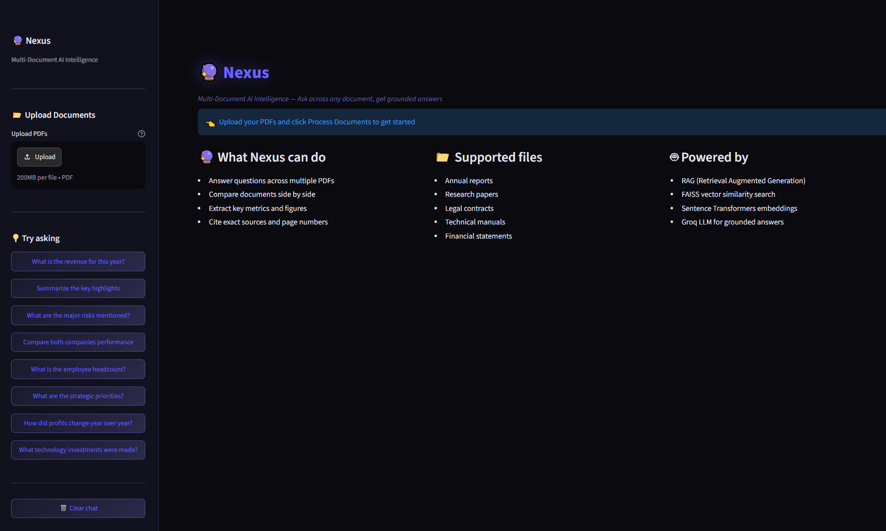
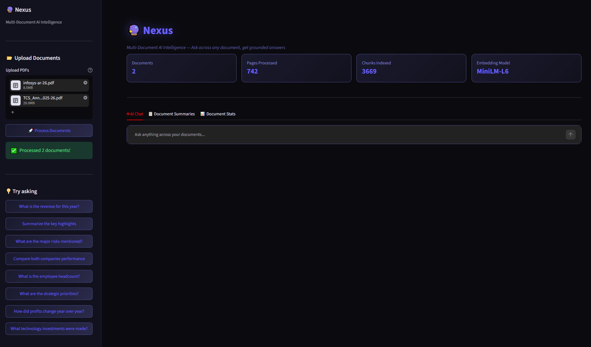
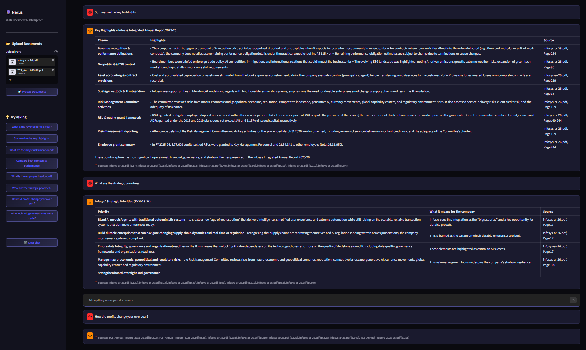
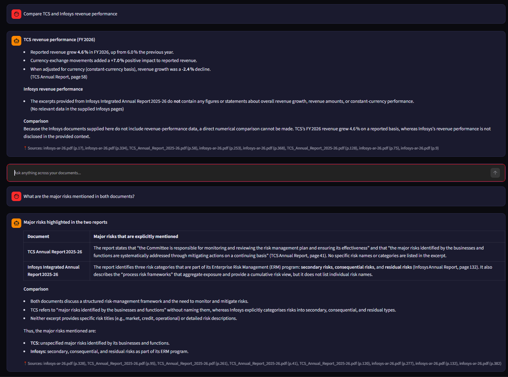
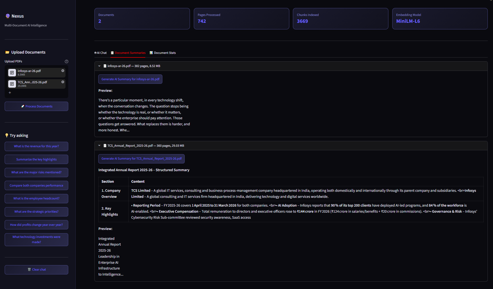
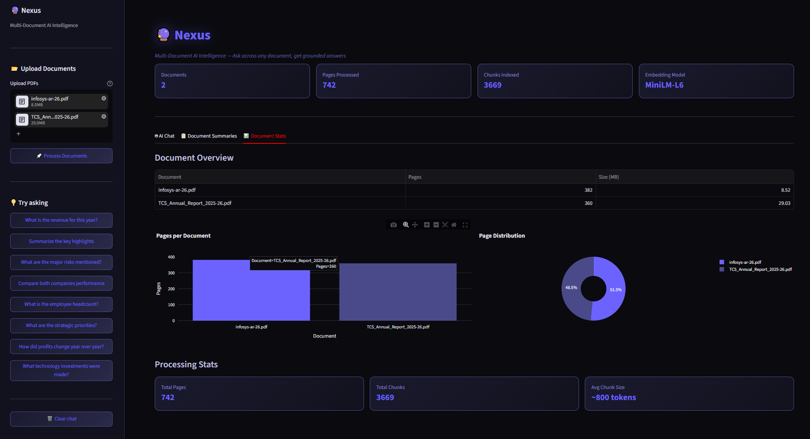

# Nexus
Multi-document AI intelligence — upload PDFs and ask questions across all of them with exact source citations using RAG, LangChain and Groq LLM


# 🔮 Nexus — Multi-Document AI Intelligence

> Upload multiple PDFs and ask questions across all of them — grounded answers with exact source citations.


---

## Demo








---

## What It Does

Upload multiple PDF documents — annual reports, research papers,
contracts, manuals — and ask questions across all of them:

- *"Compare TCS and Infosys revenue performance"*
- *"What are the major risks mentioned in both documents?"*
- *"What technology investments were made?"*
- *"Summarize the key highlights of each document"*
- *"How did profits change year over year?"*

Nexus retrieves the most semantically relevant chunks across all
documents and generates grounded answers with exact page citations —
no hallucinations, no made-up figures.

---

## Demo Data — TCS vs Infosys Annual Reports 2025-26

| Metric | Value |
|--------|-------|
| Documents analyzed | 2 annual reports |
| Total pages processed | 742 pages |
| Total chunks indexed | 3,669 chunks |
| TCS report size | 360 pages |
| Infosys report size | 382 pages |
| Chunk size | 800 tokens |
| Chunk overlap | 100 tokens |

---

## How It Works — RAG Pipeline

```
User uploads multiple PDFs
        ↓
PyMuPDF text extraction (page by page)
        ↓
RecursiveCharacterTextSplitter
(800 token chunks, 100 token overlap)
        ↓
Custom vector embeddings (numpy cosine similarity)
        ↓
SimpleVectorStore — semantic similarity search
        ↓
Top 8 chunks retrieved with source + page metadata
        ↓
Context + question → Groq LLM
        ↓
Grounded answer with page citations
```

---

## Tech Stack

| Layer | Technology |
|-------|-----------|
| UI | Streamlit + custom purple theme |
| PDF extraction | PyMuPDF |
| Text splitting | LangChain RecursiveCharacterTextSplitter |
| Vector store | Custom numpy cosine similarity |
| LLM | Groq API |
| Data processing | Pandas |
| Visualization | Plotly Express |
| Environment | python-dotenv |

---

## Project Structure

```
Nexus/
├── app.py                     # Main Streamlit app
├── utils/
│   ├── pdf_processor.py       # PDF extraction + chunking
│   ├── rag_engine.py          # Vector store + RAG pipeline
│   └── __init__.py
├── screenshots/               # 6 demo screenshots
├── .streamlit/
│   └── config.toml            # Purple theme
├── requirements.txt
└── .env                       # API key (not pushed)
```

---

## How to Run

**1. Clone the repo**
```bash
git clone https://github.com/aryzus/Nexus.git
cd Nexus
```

**2. Create virtual environment**
```bash
python -m venv venv
venv\Scripts\activate
```

**3. Install dependencies**
```bash
pip install -r requirements.txt
```

**4. Add your API key**
```
GROQ_API_KEY=your-groq-key-here
```
Get a free key at console.groq.com

**5. Run the app**
```bash
python -m streamlit run app.py
```

**6. Upload and analyze**
- Upload any PDF documents
- Click Process Documents
- Start asking questions across all documents

---

## Key Features

- **Multi-document RAG** — query across multiple PDFs simultaneously
- **Source citations** — every answer shows exact document and page number
- **Cross-document comparison** — ask Nexus to compare documents directly
- **Auto document summary** — one-click AI summary for each uploaded PDF
- **Document stats** — visual breakdown of pages and size per document
- **Chat history** — full conversation context maintained per session
- **Purple/indigo theme** — clean professional dark UI

---

## Skills Demonstrated

- **RAG pipeline** — PDF extraction, chunking, embedding, retrieval
- **LangChain** — text splitting, document processing
- **Custom vector store** — numpy cosine similarity without heavy dependencies
- **PyMuPDF** — production-grade PDF text extraction
- **Prompt engineering** — multi-document grounded Q&A with citations
- **Streamlit** — multi-tab UI with custom purple theme
- **Groq API** — fast LLM inference for document Q&A
- **Plotly** — document statistics visualization

---

## Future Improvements

- FAISS or ChromaDB for production-scale vector search
- Sentence Transformers for semantic embeddings
- PDF table and image extraction
- Export conversation as PDF report
- Support for Word documents and Excel files
- Keyword highlighting showing exactly where answer came from

---
